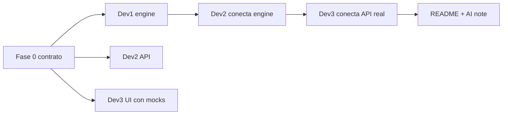

# Plan de trabajo del equipo – Disruption Companion

> Fuente: `openspec/project.md`. Las decisiones marcadas ⏳ las define el equipo antes de codificar.

## Decisiones clave pendientes (el equipo decide)
| # | Decisión | Opciones | Estado |
|---|----------|----------|--------|
| D1 | Patrón del evaluador de políticas | **Rule Map** | ✅ |
| D2 | Arquitectura backend | **Capas** (api → services → integrations/models) | ✅ |
| D3 | Frontend | **TypeScript** · sin Tailwind (CSS propio) | ✅ |
| D4 | Tiempo mínimo de conexión (MCT) | **15 min** | ✅ |
| D5 | Modificación relevante | Ver `project.md` → Decisiones | ✅ |
| D6 | Datos visibles al pasajero | Ver `project.md` → Decisiones | ✅ |
| D7 | Uso de IA en runtime | **Ninguno** por ahora (plantillas); LLM más adelante para una utilidad puntual | ✅ |
| D8 | Asignación Dev 1 / 2 / 3 | Cada integrante elige su rol | ⏳ |

## Fase 0 – Contrato compartido (bloqueante, ~1 commit, Dev 2)
Rama `feat/add-disruption-contract` → PR → merge a `main` **antes** que todo lo demás.
- `openspec/changes/add-disruption-contract/` (proposal, tasks, spec con el request/response).
- `backend/app/schemas/disruption.py`: `ResolveRequest`, `ResolveResponse`, `TripSummary`, `Event`, `Entitlement`, `Decision`, `Option`.
- `backend/app/integrations/fixtures/*.json`: los 5 JSON del examen tal cual.
- `frontend/src/mocks/resolve-ABC123.json`: respuesta de ejemplo del endpoint.

Con esto Dev 1 sabe qué devolver, Dev 3 puede pintar la UI sin backend, y Dev 2 puede armar el endpoint con un stub.

---

## Dev 1 – Core backend y algoritmia
**Rama:** `feat/add-disruption-engine` · **Change:** `openspec/changes/add-disruption-engine/`

| # | Commit | Archivos |
|---|--------|----------|
| 1 | `docs: propose add-disruption-engine` | proposal, tasks, design (D1, D2), specs/disruption-engine |
| 2 | `feat: mock adapters for external tools` | `app/integrations/` (7 tools, mismos contratos; 409/503/422 simulables) |
| 3 | `feat: event reconciliation` | `app/services/event_reconciler.py` (descarta `sources_degraded`, gana `recorded_at` más reciente) + tests |
| 4 | `feat: trip impact analysis` | `app/services/trip_impact.py` (nueva llegada, `missed_connection` con D4, relevancia D5) + tests |
| 5 | `feat: policy engine` | `app/services/policy_engine.py` (patrón D1, verifica versión) + tests R1–R5 |
| 6 | `feat: decision maker` | `app/services/decision.py` (AUTO / HUMAN / INFO_ONLY, filtra opciones por política y TTL) |
| 7 | `test: base case ABC123` | test end-to-end: R3+R5 → caso humano, sin rebooking automático |

## Dev 2 – Infra, API y persistencia
**Rama:** `feat/add-disruption-api` · **Change:** `openspec/changes/add-disruption-api/`

| # | Commit | Archivos |
|---|--------|----------|
| 0 | Fase 0 (contrato) | ver arriba |
| 1 | `docs: propose add-disruption-api` | proposal, tasks, design (tablas, idempotencia) |
| 2 | `feat: alembic + audit/idempotency tables` | `app/db/migrations/`, `app/models/decision_audit.py`, `idempotency_key.py` |
| 3 | `feat: POST /disruptions/resolve` | `app/api/disruptions.py` (usa stub hasta merge de Dev 1, luego `decision.py`), registra auditoría |
| 4 | `feat: POST /disruptions/rebooking` | idempotency key, manejo 201/409/503 (503 = estado INDETERMINATE, consulta antes de reintentar) |
| 5 | `feat: human case + notify` | `POST /disruptions/escalate`, notificación solo con `policy_ref` |
| 6 | `feat: PII masking + error handlers` | `app/core/` (D6) |
| 7 | `docs: engineering README + AI note` | `docs/ENGINEERING_README.md`, `docs/AI_USAGE_NOTE.md` (tabla de pasos) |

## Dev 3 – Frontend y UX
**Rama:** `feat/add-disruption-ui` · **Change:** `openspec/changes/add-disruption-ui/`

| # | Commit | Archivos |
|---|--------|----------|
| 1 | `docs: propose add-disruption-ui` | proposal, tasks, wireframe en design.md |
| 2 | `chore: frontend setup (D3)` | Tailwind/TS si se decide, layout, router |
| 3 | `feat: disruption api client` | `src/services/disruptionApi.js` con flag para usar `src/mocks/` |
| 4 | `feat: booking search page` | `src/pages/SearchPage` (validación de `booking_id`) |
| 5 | `feat: trip status view` | `src/components/TripTimeline`, `EventBadge` (retraso, conexión perdida) |
| 6 | `feat: options and actions` | `OptionCard`, botones Reagendar/Reembolso, estado "caso humano en curso" |
| 7 | `feat: loading/error states + real API` | quitar mocks, manejar 409/503/422 |

---

## Reglas de sincronización
1. **Orden de merge a `main`:** Fase 0 → propuestas (3 PR cortos) → Dev 1 → Dev 2 → Dev 3 → docs.
2. Cada uno hace `git pull --rebase origin main` al empezar el día y antes de abrir PR.
3. El contrato (`schemas/disruption.py`) solo se cambia con un PR propio y aviso al grupo.
4. Push frecuente a tu rama (cada commit de la tabla); PR pequeño cuando un bloque funciona.
5. Al terminar: archivar los changes en `openspec/changes/archive/`.

