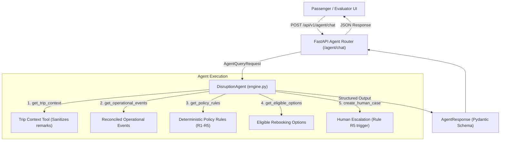

# Design: Agent API Endpoint, Chat Interface & Technical Architecture

## 1. Architecture Overview

The Agent API bridges the user interface with the backend autonomous agent engine.

## 2. Decision D13 Rationale: REST API vs CLI / Direct Function
- A REST endpoint under `/api/v1/agent/chat` adheres to the existing architecture pattern established in Part 1.
- Allows both direct HTTP testing via curl/Postman/Swagger and interactive end-user testing in the web application.
- Exposes structured telemetry (`tools_invoked`, `policy_refs`, `human_required`, `metadata`) alongside the conversational `passenger_reply`.

## 3. UI Design Considerations
- The UI must offer an immediate demonstration mode for the target conversation (Maria & Tomás on booking `ABC123`).
- A quick-action button pre-fills the exact prompt from the examination.
- Dual visual panels:
  - **Conversational View:** Natural language dialogue showing the passenger question and the agent's empathetic response.
  - **Agentic Trajectory Inspector:** Clear badges and cards displaying:
    1. Operational discovery (delayed flight, missed connection).
    2. Policy evaluations (matched rules and entitlements).
    3. Mandatory Human-in-the-Loop badge (escalation case HC-4471 with 45 min SLA).
    4. Tool trajectory trace (ordered list of tools executed by the agent loop).

## 4. Security & Privacy Guardrails
- The client-side and server-side endpoints never expose unmasked PII (phone numbers, emails, documents).
- The passenger response is strictly grounded in `policy_refs` returned by deterministic policy evaluation.
- The UI clearly signals when human review is required, disabling autonomous unilateral rebooking.

